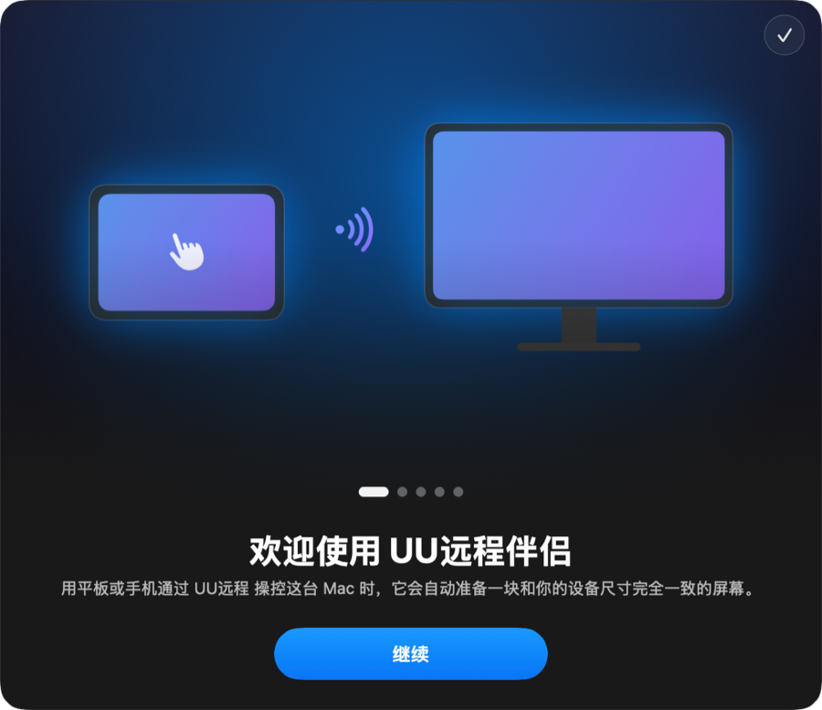
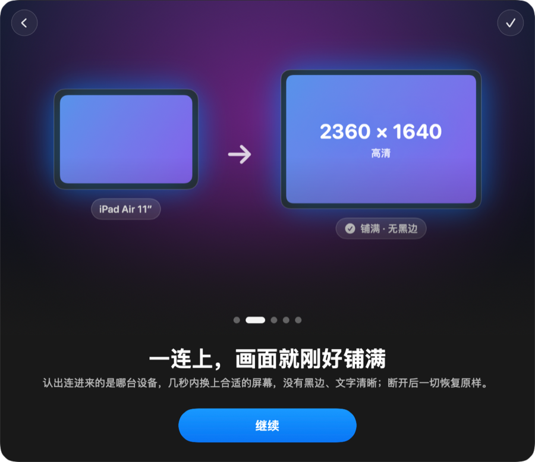
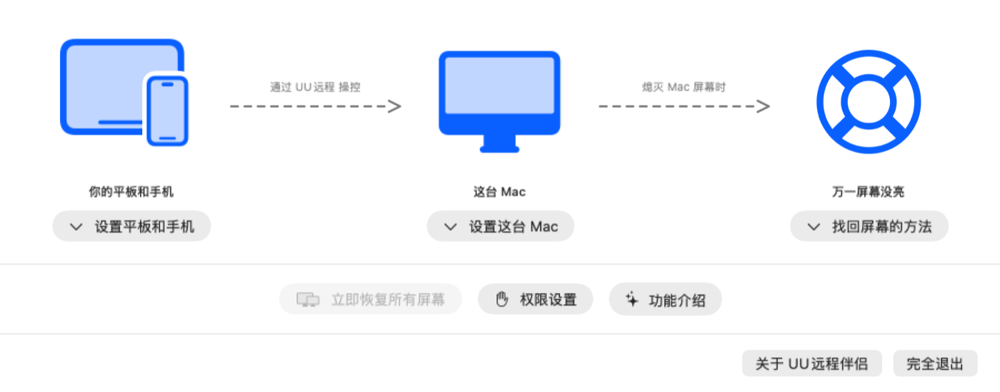
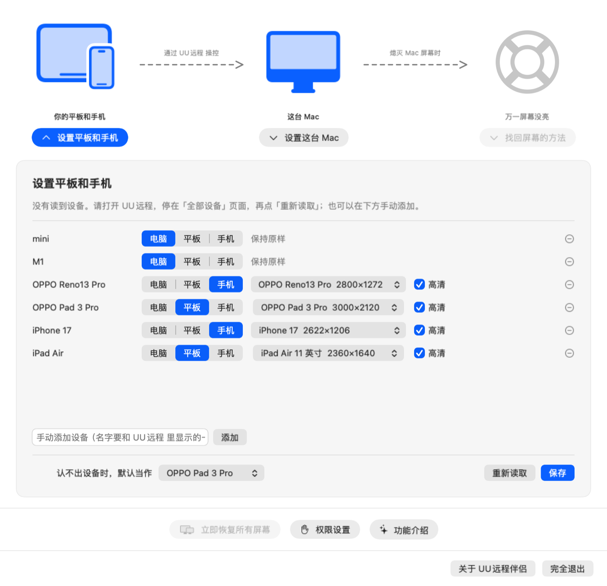
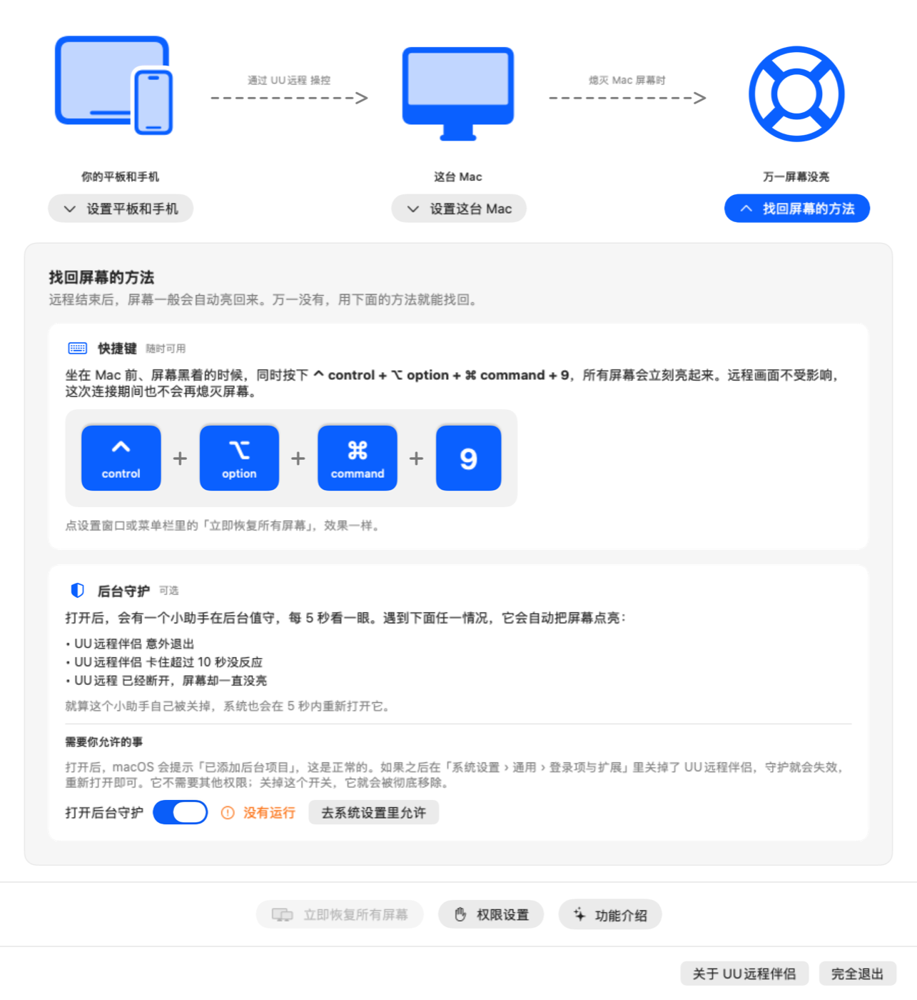

<div align="center">



# UU远程伴侣（UUyc companion）

**用平板或手机通过 UU远程 操控 Mac 时，自动准备一块尺寸刚好的屏幕。**

画面铺满、没有黑边、文字清晰；断开后一切恢复原样。

[](https://github.com/aoyamashou/UUyc-companion/releases/latest)


[](LICENSE)

[下载](#下载) · [安装](#安装) · [使用](#使用) · [注意事项](#注意事项) · [常见问题](#常见问题) · [English](#english)

</div>

---

## 为什么需要它

用 iPad 或手机远程操控 Mac 时，Mac 屏幕的比例和平板、手机不一样，远程画面上下或左右总有黑边，字也很小。每次连接都要手动调分辨率，断开后再调回来，很麻烦。

UU远程 的 Mac 被控端没有 Windows 版那样的「超级屏」（虚拟屏幕）功能，所以有了这个小工具：

- 平板或手机一连上，它就自动准备一块和你的设备**尺寸完全一致**的虚拟屏幕，远程画面刚好铺满
- 可以选择在远程期间**暂时熄灭 Mac 自己的屏幕**，窗口不会跑到你看不见的地方
- 断开后，屏幕、窗口位置、显示器排列**全部自动还原**

<div align="center">


</div>

## 功能

| 功能 | 说明 |
| --- | --- |
| 🖥️ 自动准备虚拟屏幕 | 认出连进来的是哪台设备，几秒内换上合适尺寸的屏幕，高清显示 |
| 📱 每台设备单独设置 | 自动读取 UU远程 里的设备列表，按名称预填平板、手机、电脑和屏幕尺寸，可以自定义 |
| 💻 用电脑连接时不打扰 | 用另一台电脑连接时，什么也不做 |
| 🌑 远程时熄灭 Mac 的屏幕 | 可选。远程期间只留虚拟屏幕，断开后自动亮回来 |
| ⌨️ 一键找回屏幕 | 坐在 Mac 前按 **⌃ control + ⌥ option + ⌘ command + 9**，所有屏幕立刻亮起来 |
| 🛡️ 后台守护 | 可选。万一程序意外退出或卡住，后台的小助手会自动把屏幕点亮 |
| 🔒 不联网 | 不连接任何服务器，不收集任何数据 |

## 截图

<div align="center">

<p><sub>设置窗口：上面的图示说明了工作方式，点按钮展开对应的设置</sub></p>

<p><sub>设置平板和手机：为每台设备选择屏幕尺寸</sub></p>

<p><sub>找回屏幕的方法：快捷键与后台守护</sub></p>
</div>

## 系统要求

- **macOS 14 Sonoma 或更新版本**（作者在 macOS 27 · Apple Silicon 上测试）
- 被操控的 Mac 上已安装 **[UU远程](https://uuyc.163.com/)**
- 平板或手机上装有 UU远程，并能正常连接这台 Mac

> 需要「被操控」的每一台 Mac 上都安装本软件；平板和手机上不需要装任何东西。

## 下载

前往 **[Releases 页面](https://github.com/aoyamashou/UUyc-companion/releases/latest)**，下载 `UUyc-companion-<版本号>.zip`。

## 安装

1. 双击下载的 `.zip` 解压，得到 **UU远程伴侣**（`UUyc companion.app`）
2. 把它拖进「**应用程序**」文件夹
3. 第一次打开时，macOS 可能会拦住它，请看下面的「解除隔离」

### 解除隔离（第一次打开被拦住时）

本软件使用作者自己的证书签名，**没有经过苹果公证**（公证需要付费的苹果开发者账号）。所以第一次打开时，macOS 可能提示「无法打开」「无法验证开发者」或「已损坏」。这不代表软件有问题，按下面任一方法放行即可：

**方法一：在系统设置里放行（推荐）**

1. 先双击打开一次，看到提示后点「完成」或「好」
2. 打开「**系统设置 › 隐私与安全性**」，往下滚动到「安全性」
3. 找到关于「UUyc companion」的提示，点「**仍要打开**」，再输入密码确认

**方法二：用终端命令**

打开「终端」，粘贴下面这行并回车：

```bash
xattr -dr com.apple.quarantine "/Applications/UUyc companion.app"
```

这行命令会去掉 macOS 给下载文件加的「隔离」标记，之后就能正常双击打开了。

> 在较旧的 macOS 上，也可以按住 Control 键点按 App，选「打开」。新版 macOS 已经取消了这个方式，请用上面两种方法。

## 使用

### 第一次打开

1. **功能介绍**：5 页图文，介绍它能做什么
2. **授权**：允许它读取 UU远程 里显示的设备名称。点「授权」后会打开系统设置，旁边出现一个小窗口，把里面的 UU远程伴侣 拖进列表就好
   - 这一项在 macOS 27 里叫「**设备控制和数据访问**」，更早的版本叫「**辅助功能**」
3. **设置平板和手机**：软件会自动读出你的 UU远程 账号里已登录的设备，确认每台设备的类型和屏幕尺寸后点「保存」。**屏幕尺寸务必核对**，见下一节

之后它会待在**菜单栏**里（图标是两块叠在一起的屏幕），平板或手机连上就会自动工作。

### 核对每台设备的屏幕尺寸（重要）

软件会根据设备名称自动分配屏幕尺寸（分辨率）：

| 情况 | 自动分配的结果 |
| --- | --- |
| 软件认识的型号 | 直接填好分辨率：OPPO Pad 3 Pro、iPad mini、OPPO Reno13 Pro；名字带「iPad Air」「iPad Pro」的按 **11 英寸**填写（13 英寸请在下拉框里改选）；名字带「iPhone」的一律按 **iPhone 17** 填写（其他型号请核对） |
| 软件不认识的平板 | 先按 iPad Air 11 英寸（2360 × 1640）填写，**不一定适合你的设备** |
| 软件不认识的手机 | 先按常见安卓手机（2400 × 1080）填写，**不一定适合你的设备** |
| 电脑 | 不需要尺寸，连上时什么也不做 |

> 设备类型也是按名字判断的：UU远程「电脑」分组里的都当作电脑；其余名字带「Pad」的当作平板，不带的当作手机。判断错了，在这台设备那一行点选正确的类型即可。

如果你的设备不在「认识的型号」里，或者连上后画面有黑边，请查到它的屏幕分辨率，再手动填写：

1. **查分辨率**：在设备的官方规格页找「屏幕分辨率」，或者搜索「设备型号 + 分辨率」。例如 iPad Air 11 英寸是 2360 × 1640
2. 点菜单栏图标 › **设置…** › **设置平板和手机**
3. 在这台设备的尺寸下拉框里选「**自定义**」
4. 填写**宽**和**高**：
   - 按**横屏**填写：两个数字中**大的填「宽」，小的填「高」**
   - 直接填规格表上的原始数字，**不要自己除以 2**
5. 「**高清**」保持勾选（推荐），文字更清晰
6. 点「**保存**」，立即生效（正在连接时也会马上换成新的尺寸）

> 填的比例和设备屏幕对不上时，远程画面会出现黑边。按上面的步骤改正即可，不会造成其他影响。

### 设置

点菜单栏图标 › **设置…**

- **设置平板和手机**：每台设备用什么屏幕尺寸；认不出设备时默认当作哪台
- **设置这台 Mac**：开机时自动打开、自动准备虚拟屏幕、远程时熄灭 Mac 的屏幕
- **找回屏幕的方法**：打开「远程时熄灭 Mac 的屏幕」后才能点，可以在这里打开后台守护

### 万一屏幕没有亮回来

开启「远程时熄灭 Mac 的屏幕」后，万一远程结束屏幕还是黑的：

1. 坐在 Mac 前按 **⌃ control + ⌥ option + ⌘ command + 9**，所有屏幕立刻亮起来
2. 重新打开 UU远程伴侣，它会自动恢复
3. 重启 Mac，一定能恢复

建议在「找回屏幕的方法」里打开**后台守护**：程序意外退出或卡住时，它会在几秒内自动把屏幕点亮。

## 注意事项

- **使用了 macOS 未公开的接口**：创建虚拟屏幕、熄灭屏幕都依赖 macOS 没有公开的系统接口。macOS 大版本升级后可能失效，建议升级系统后先简单测试一次
- **熄灭屏幕是可选功能，请先了解找回方法**：开发过程中，在极端情况下（短时间内反复增减屏幕）曾遇到 macOS 显示服务重启，表现为被注销到登录界面。现在的版本已经加了多重保护并通过压力测试，但无法完全排除这种可能。**远程前请保存好重要工作**
- **不是网易官方软件**：本软件与网易、UU远程没有任何关系。它通过读取 UU远程 窗口上的文字来识别设备，如果 UU远程 改版，可能会读不到设备名，这时会按「默认设备」处理
- **隐私**：不联网、不收集任何数据。授权后只用来读取 UU远程 窗口里显示的设备名称
- **后台守护**：打开后会在「系统设置 › 通用 › 登录项与扩展」里出现，macOS 会提示「已添加后台项目」，这是正常的

## 常见问题

<details>
<summary><b>设置里读不到 UU远程 的设备？</b></summary>

请确认：已经完成授权（设置窗口里点「权限设置」查看）；UU远程 已经打开，并停在「全部设备」页面。然后点「重新读取」。也可以手动添加设备，名字要和 UU远程 里显示的一样。
</details>

<details>
<summary><b>连上后画面还是有黑边？</b></summary>

1. 在「设置平板和手机」里，确认这台设备选的屏幕尺寸和它的实际分辨率一致（横屏）
2. 在平板或手机的 UU远程 里打开「显示」面板，确认选中的显示屏是「UUyc companion · 设备名」
</details>

<details>
<summary><b>升级后又提示需要授权？</b></summary>

通常不需要重新授权。如果「权限设置」里显示未授权，而系统设置的列表里已经有 UU远程伴侣 或 UUDisplay（旧名字）：先选中它，点「−」删掉，再重新授权一次。
</details>

<details>
<summary><b>菜单栏里找不到图标？</b></summary>

菜单栏图标太多时，macOS 会把一部分藏起来。可以按住 ⌘ command 拖动其他图标腾出位置，或者用菜单栏管理工具。
</details>

<details>
<summary><b>用另一台电脑连接时会怎样？</b></summary>

在「设置平板和手机」里，类型为「电脑」的设备连上时，本软件什么也不做。
</details>

## 卸载

1. 如果打开过后台守护，先在「设置 › 找回屏幕的方法」里**关掉后台守护**（这会把它彻底移除）
2. 在设置窗口点「**完全退出**」，或在菜单栏菜单里点「退出」
3. 把「应用程序」文件夹里的 **UU远程伴侣** 移到废纸篓
4. 可选：删除设置和日志

   ```bash
   rm -rf ~/Library/Application\ Support/UUDisplay ~/Library/Logs/UUDisplay.log
   ```

5. 可选：在「系统设置 › 隐私与安全性 › 设备控制和数据访问（辅助功能）」里删掉 UU远程伴侣

## 从源码构建

需要 macOS 14 以上和 Xcode 命令行工具（Swift 6）：

```bash
git clone https://github.com/aoyamashou/UUyc-companion.git
```

```bash
cd UUyc-companion && SIGN_IDENTITY=- scripts/build-app.sh
```

生成的 App 在 `build/UUyc companion.app`。加上 `--install` 参数会安装到「应用程序」文件夹并打开。

- `SIGN_IDENTITY=-` 表示用 ad-hoc 签名。缺点是每次重新构建后，系统授权都会失效，需要重新授权。如果你有自己的代码签名证书，把 `-` 换成证书名称，升级后授权就能保留
- 只装了命令行工具（没有完整 Xcode）也能构建：内置的 PermissionFlow 和 TourKit 已经把需要 Xcode 宏插件的写法改掉了，详见各自目录下的 `VENDORED.md`

<details>
<summary><b>工作原理</b></summary>

- **检测连接**：UU远程 被操控时，会在每块屏幕上铺一层透明窗口，本软件据此判断有没有设备连上
- **识别设备**：通过 macOS 辅助功能接口读取 UU远程 窗口里「本机被控中」显示的设备名称
- **虚拟屏幕**：用 CoreGraphics 未公开的 `CGVirtualDisplay` 创建一块指定分辨率的高清屏幕，并设为主屏幕
- **熄灭屏幕**：用未公开的 `CGSConfigureDisplayEnabled` 暂时停用其他显示器；停用前会把要恢复的屏幕记下来
- **后台守护**：一个独立的 LaunchAgent 进程，每 5 秒检查一次，发现主程序退出、卡住或 UU远程 已断开时，按记录恢复屏幕
</details>

## 致谢

- [FreeDisplay](https://github.com/huberdf/FreeDisplay)（MIT）：`CGVirtualDisplay` 接口声明
- [PermissionFlow](https://github.com/jaywcjlove/PermissionFlow)（MIT）：授权引导与拖拽授权面板
- [TourKit](https://github.com/rampatra/TourKit)（MIT）：功能介绍页
- 虚拟屏幕的实现思路参考了 [DeskPad](https://github.com/Stengo/DeskPad)、[Side Screen](https://github.com/tranvuongquocdat/SideScreen) 和 Chromium 的相关代码

## 许可证

[MIT](LICENSE) © 2026 AoyamaShou

---

## English

**UUyc companion** is a macOS menu bar utility for people who control their Mac from an iPad or phone with [UU Remote](https://uuyc.163.com/) (NetEase).

When a tablet or phone connects, it creates a HiDPI virtual display that exactly matches the device's resolution and makes it the main display, so the remote view fills the screen with no black bars. It can optionally turn off the Mac's own displays during the session, and everything is restored when the session ends.

- Reads the device list from UU Remote and pre-fills a resolution for each device; computers are left alone
- Emergency shortcut **⌃⌥⌘9** turns all displays back on; an optional background watchdog restores them if the app crashes or hangs
- No network access, no data collection
- Requires macOS 14+; tested on macOS 27 (Apple Silicon)
- Uses private macOS APIs (`CGVirtualDisplay`, `CGSConfigureDisplayEnabled`) that may break with future macOS releases
- Self-signed and not notarized. If macOS blocks it on first launch, allow it in *System Settings › Privacy & Security*, or run `xattr -dr com.apple.quarantine "/Applications/UUyc companion.app"`
- Not affiliated with NetEase or UU Remote

The user interface is in Simplified Chinese. Licensed under [MIT](LICENSE).
