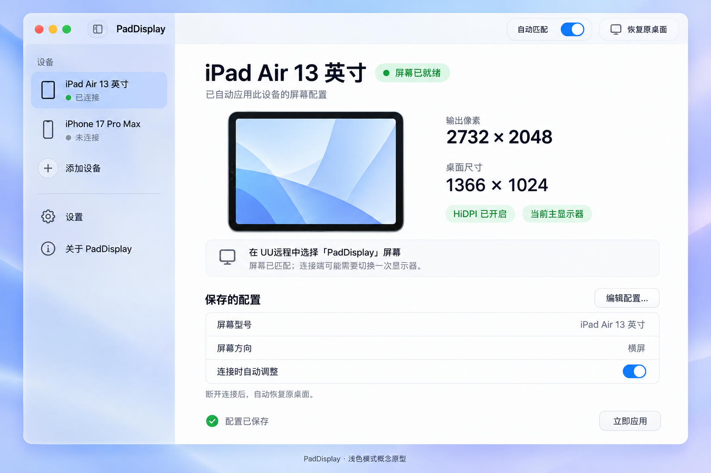
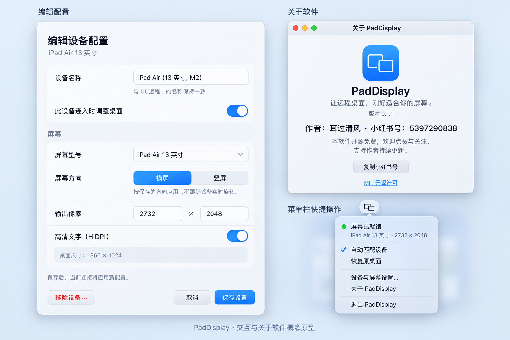
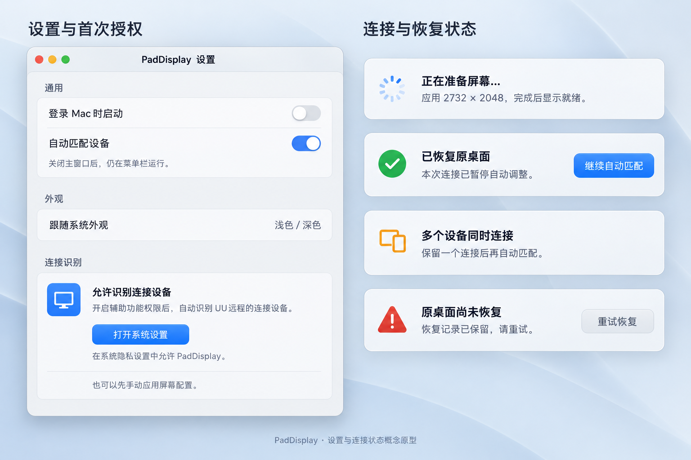
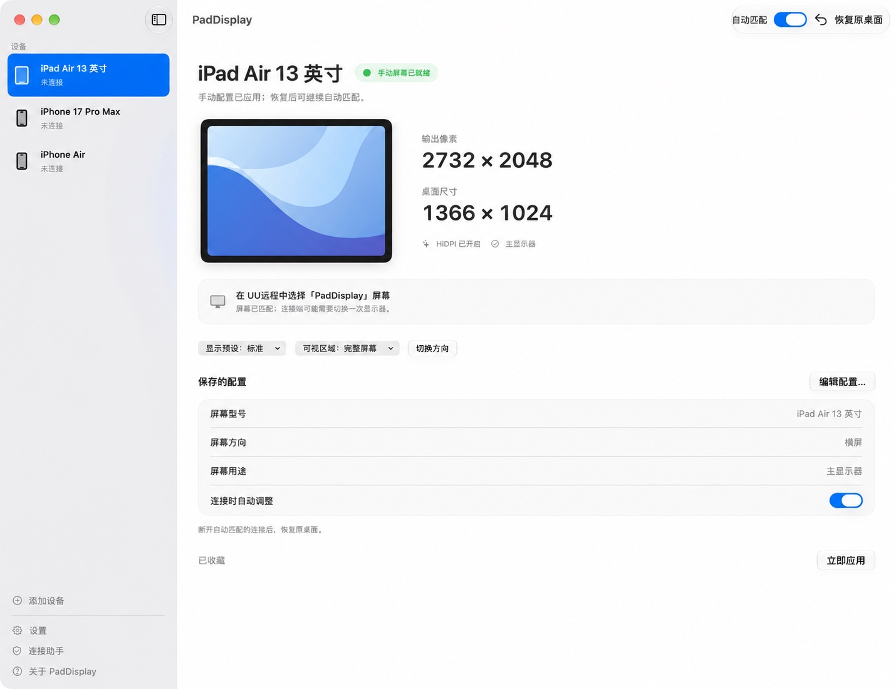
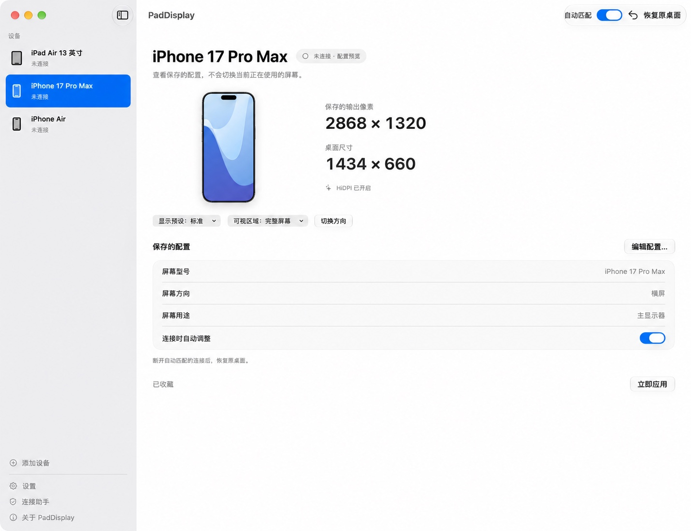
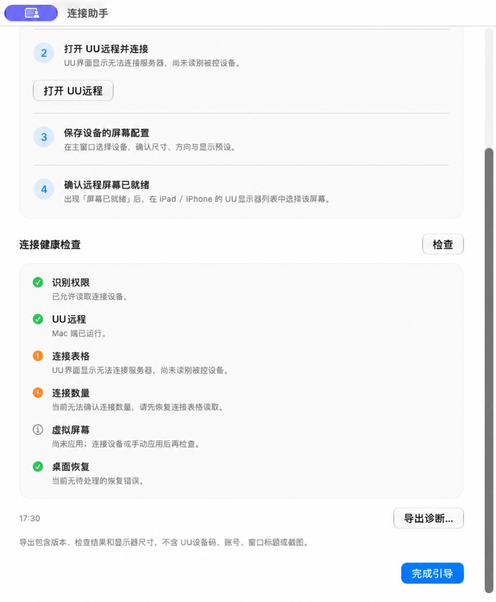

# PadDisplay

**让远程桌面，刚好适合你的屏幕。**


[](LICENSE)

[功能特色](#功能特色) · [界面设计](#界面设计) · [安装与使用](#安装与使用) · [设备配置](#设备配置) · [常见问题](#常见问题) · [从源码构建](#从源码构建) · [参与贡献](#参与贡献)

PadDisplay 是一款**开源免费的原生 macOS 远程桌面助手**，安装在被控 Mac 上，配合 UU远程使用。它读取当前连接设备的名称，为 iPad、iPhone 等设备匹配各自的屏幕配置，创建对应比例的高清虚拟屏幕；自动匹配的连接断开后，移除虚拟屏幕并恢复原显示器布局。

如果你用 iPad 远程连接 Mac，却因为两端屏幕比例不同而遇到黑边、文字过小或桌面尺寸不合适，PadDisplay 可以让远程桌面按你的设备尺寸显示。更换设备时，也可以自动使用另一套保存的配置。

<picture>
  <source media="(prefers-color-scheme: dark)" srcset="docs/images/prototype-main-dark.png">
  <source media="(prefers-color-scheme: light)" srcset="docs/images/prototype-main-light.png">
  
</picture>

*主界面设计原型，支持随页面浅深色主题切换。原型图展示视觉与交互设计，实际界面见下方[原生界面展示](#原生界面展示)。*

## 功能特色

| 功能 | 说明 |
| --- | --- |
| 按设备自动匹配 | 根据 UU远程显示的设备名称，应用保存的尺寸、方向和 HiDPI 设置 |
| 高清虚拟屏幕 | 创建 `PadDisplay · 设备名` 屏幕，可选主显示器或扩展显示器 |
| 固定屏幕身份 | 同一设备配置复用固定序列号，重连、修改尺寸和方向保持身份 |
| 独立设备配置 | 分别保存 iPad、iPhone 和自定义设备的配置，切换连接时重新匹配 |
| 清晰的文字与界面 | 支持 HiDPI，以两倍输出像素呈现逻辑桌面 |
| 断开后恢复桌面 | 保存并核对原显示模式、逻辑缩放、刷新率、主屏和布局；可还原普通窗口位置 |
| 显示与区域预设 | 标准、更大文字、更多空间，以及完整屏幕、约 ⅔／½ 宽度 |
| 连接助手与诊断 | 检查权限、UU连接表格、设备配置、实际输出和恢复状态，可导出诊断 |
| 收藏与快捷操作 | 菜单栏收藏、可选全局快捷键、横竖屏切换及快捷指令链接 |
| 配置导入与备份 | 导出 JSON，预览后合并或替换，自动保存导入前备份 |
| 应用内更新 | 从项目发布源检查更新，校验 SHA-256 和现有签名身份后安装 |
| 手动应用与恢复 | 提供「立即应用」「恢复原桌面」及明确的暂停、失败提示 |
| 原生 macOS 体验 | SwiftUI 侧边栏、配置浮层、菜单栏、设置窗口和 macOS 26+ Liquid Glass 控件 |
| 本地保存 | 无第三方 Swift 包依赖；设备配置和布局记录保存在本机 |

设备识别依赖 **UU远程中的设备名称**。名称包含明确型号时，可以自动预填内置尺寸；使用昵称或型号不明确时，需要手动选择型号或填写尺寸。

## 界面设计

设计采用清晰的设备侧边栏、集中展示的屏幕状态、独立的配置编辑窗口，以及跟随系统外观的玻璃控件。iPad 默认横屏展示，iPhone 使用写实机身并固定竖直展示。

### 配置、关于与菜单栏原型



### 设置与连接状态原型



### 原生界面展示

下面两张为 **0.3.0 的原生运行截图**，已清除鼠标指针与光晕。iPad 展示手动应用的真实屏幕配置，iPhone 展示未连接设备的保存配置；预览另一台设备不会切换当前屏幕。

<details>
  <summary>查看原生 iPad 主界面</summary>
  <p></p>
</details>

iPhone 的机身示意固定竖直，灵动岛位于顶部。实际远程桌面仍可按配置使用横屏或竖屏。



连接助手会检查实际权限、连接读取和屏幕状态。下图展示 UU界面暂时无法连接服务器时的诊断；无法读取的连接数量会明确标为未知。



## 运行环境

| 项目 | 要求或当前验证范围 |
| --- | --- |
| 安装位置 | 被远程控制的 Mac |
| 系统 | 声明的最低运行版本为 macOS 14；Liquid Glass 控件在 macOS 26+ 启用 |
| 架构 | 当前安装包为 Apple Silicon / arm64 |
| 远程软件 | Mac 端与连接端均使用 UU远程；已验证 Mac 端 UU远程 4.42.0 |
| 识别权限 | 允许 PadDisplay 使用「辅助功能」；部分系统显示为「设备控制和数据访问」 |
| 真实验证环境 | Mac Studio、Apple M1 Max、macOS 27.0.1，iPad Air 13 英寸与 iPhone 17 Pro Max |

其他系统版本、Intel Mac 和其他远程软件尚未逐一验证。虚拟屏幕使用 macOS 私有接口，兼容性会受系统及 UU远程界面变化影响。

## 安装与使用

### 1. 获取应用

当前版本为 **[0.3.0](https://github.com/sincere518/PadDisplay/releases/tag/v0.3.0)**。下载 [DMG 安装包](https://github.com/sincere518/PadDisplay/releases/download/v0.3.0/PadDisplay-0.3.0-arm64.dmg)，或使用 [ZIP 安装包](https://github.com/sincere518/PadDisplay/releases/download/v0.3.0/PadDisplay-0.3.0-arm64.zip)。获取本仓库源码后，也可按[从源码构建](#从源码构建)生成应用。

正式打包产物为：

```text
dist/PadDisplay.app
dist/PadDisplay-0.3.0-arm64.dmg
dist/PadDisplay-0.3.0-arm64.zip
dist/PadDisplay-update.json
dist/SHA256SUMS.txt
```

`dist/` 是本地构建产物目录，不提交到 Git。项目沿用固定的本机开发签名，用于稳定系统授权；本版本不新增 Developer ID 正式签名或 Apple 公证。

### 2. 安装并授权

1. 打开 DMG，将 `PadDisplay.app` 拖入「应用程序」；也可解压 ZIP 后安装。
2. 点击「打开系统设置」，在「隐私与安全 → 辅助功能」中允许 **PadDisplay**。部分系统将该项显示为「设备控制和数据访问」。
3. 打开 UU远程主界面，使「本机被控中」的连接设备表格可读取。
4. 确认 PadDisplay 工具栏中的「自动匹配」已开启。

首次启动会打开「连接助手」。权限用于读取 UU界面里的设备名称和连接数量，以及按设置还原普通窗口位置。未授权时，可以使用「立即应用」手动验证显示效果。

### 3. 连接设备

1. 用 iPad 或 iPhone 的 UU远程连接这台 Mac。
2. PadDisplay 匹配该设备的配置。明确型号的新设备会自动预填，其他设备可通过「添加设备」配置。
3. 等待界面显示「屏幕已就绪」，检查输出像素与桌面尺寸。
4. 在连接端的 UU远程显示器列表中选择 **`PadDisplay · 设备名`**。

例如，iPad Air 13 英寸可使用 **2732 × 2048 输出像素 / 1366 × 1024 逻辑桌面**。Mac 端设为主显示器后，UU客户端仍可能需要手动切换一次采集屏幕。

### 4. 恢复与退出

自动匹配的连接断开后，PadDisplay 会移除虚拟屏幕，恢复原显示器的分辨率、逻辑缩放、可用刷新率、主屏和布局，并核对恢复结果。点击「恢复原桌面」会暂停本次连接的自动调整；点击「继续自动匹配」可重新匹配。

默认尝试还原仍存在的普通窗口位置与尺寸，可在「设置 → 通用」关闭。全屏、最小化、受保护或已经关闭的窗口可能无法还原。原显示器断开、原模式不可用或恢复未通过核对时，保留恢复记录并提示重试。0.2.x 的旧恢复记录只包含位置，升级时不会推测缺失的模式信息。

关闭主窗口后，应用继续在菜单栏运行。正常退出 PadDisplay 时，会先恢复显示器布局。

## 设备配置

### 内置尺寸

下表为软件内置的**默认横屏配置**。开启 HiDPI 后，逻辑桌面的宽高为输出像素的一半。

| 设备 | 输出像素 | HiDPI 逻辑桌面 |
| --- | --- | --- |
| iPad Air 13 英寸 | 2732 × 2048 | 1366 × 1024 |
| iPad Air 11 英寸 | 2360 × 1640 | 1180 × 820 |
| iPad Pro 13 英寸（M4 / M5） | 2752 × 2064 | 1376 × 1032 |
| iPhone Air | 2736 × 1260 | 1368 × 630 |
| iPhone 17 Pro Max | 2868 × 1320 | 1434 × 660 |

预设定义见 [DeviceProfile.swift](Sources/PadDisplayCore/DeviceProfile.swift)。其他设备可以保存自定义尺寸，实际显示效果需在对应设备上确认。

### 添加和编辑

- **设备名称**：填写 UU远程显示的完整名称。同名设备需要不同配置时，先在 UU 中改为不同名称。
- **此设备连入时调整桌面**：开启后参与自动匹配；手动新增配置默认关闭。
- **屏幕型号**：选择内置型号或自定义尺寸。未知设备的尺寸留空，确认后再保存有效配置。
- **屏幕方向**：切换横屏 / 竖屏时交换宽高。当前按保存方向应用，不跟随设备实时旋转。
- **输出像素**：宽高须为 640–8192 的整数；开启 HiDPI 时，宽高均须为偶数。
- **显示预设**：标准使用保存尺寸；更大文字将输出约缩小到 80%；更多空间约放大到 125%。这会改变实际输出像素，保持 HiDPI 的两倍像素比例。
- **可视区域**：完整屏幕或保存宽度的约 ⅔／½。预设不是实时测量结果；分屏间隔、工具栏等占用不同时，可填写自定义尺寸校准。
- **屏幕用途**：主显示器适合集中远程办公；扩展显示器保留原主屏，放在原桌面右侧，要求原显示器在线。
- **收藏**：最多九个已启用且有效的收藏显示在菜单栏快捷列表中。

编辑使用草稿，点击「保存设置」才写入配置；取消不会新增空设备或覆盖原配置。有未保存修改时，界面会显示确认提示。

### 操作行为

| 操作或状态 | 行为 |
| --- | --- |
| 选择侧边栏设备 | 查看配置；选择未连接设备不会切换当前屏幕 |
| 立即应用 | 手动应用所选配置，保持到恢复、切换自动匹配开关或退出 |
| 恢复原桌面 | 移除虚拟屏幕、恢复布局，暂停本次连接的自动调整 |
| 继续自动匹配 | 按当前连接设备重新匹配 |
| 多台设备同时连接 | 暂停自动调整，提示保留一个连接；同名连接也计入数量 |
| 关闭主窗口 | 保持菜单栏运行 |
| 正常退出 | 先恢复显示器布局，再结束进程 |

快捷键：`⌘,` 打开设置，`Escape` 取消配置编辑，`Return` 保存有效配置。侧边栏及标准应用菜单均可打开「关于 PadDisplay」。

### 收藏、快捷键与快捷指令

菜单栏可直接应用收藏设备，并切换当前设备的显示预设、区域与横竖屏。「屏幕」菜单提供 `⇧⌘R` 恢复和 `⇧⌘O` 切换方向。

在「设置 → 通用」开启全局快捷键后，即使其他应用在前台，也可使用：

| 快捷键 | 操作 |
| --- | --- |
| `⌃⌥⌘1`–`⌃⌥⌘9` | 按菜单栏顺序手动应用收藏 |
| `⌃⌥⌘0` | 恢复原桌面 |
| `⌃⌥⌘R` | 切换当前设备的横竖屏 |

右键设备选择「复制快捷指令链接」，放入 macOS「快捷指令」的「打开 URL」动作即可应用该设备。另支持 `paddisplay://restore`、`paddisplay://automatic` 和 `paddisplay://rotate`。已删除的配置不会被旧链接重新创建。

### 配置备份与连接诊断

「设置 → 配置备份」支持导出、导入与恢复导入前配置。导入文件先校验版本、尺寸、重复名称和身份，再展示预览；合并时同名设备保留本机身份，替换时使用导入文件的身份。原配置自动保存到 `~/Library/Application Support/PadDisplay/profiles-before-import.json`。

侧边栏或菜单栏的「连接助手」提供一键健康检查和 JSON 导出。诊断包含版本、检查结果与显示器尺寸，不包含 UU设备码、账号、窗口标题或截图。

### 应用内更新与发布

「设置 → 更新」或应用菜单可检查更新。默认源为 `https://github.com/sincere518/PadDisplay`；也可填写 HTTPS 更新描述文件地址。自动检查默认关闭，开启后每天最多检查一次。下载与安装均由用户点击。

更新包需通过 SHA-256、Bundle ID、版本、系统要求、架构与当前签名身份校验。安装前会恢复原桌面，随后替换应用并重新打开；目录不可写、签名身份不同或桌面尚未恢复时停止安装，并给出手动处理入口。

维护者运行 `--package` 后，将 DMG、ZIP、`PadDisplay-update.json` 和 `SHA256SUMS.txt` 一并上传到 **`v0.3.0`** 的 GitHub Release。更新描述文件引用该标签下的 ZIP，内含实际 SHA-256；若使用其他标签或附件目录，打包时通过 `RELEASE_BASE_URL` 指定真实 HTTPS 目录。检查地址为：

```text
https://github.com/sincere518/PadDisplay/releases/latest/download/PadDisplay-update.json
```

未发布描述文件时会提示暂不可用；生成本地安装包不代表已发布到 GitHub。自行构建使用不同签名身份时，需要核实后手动安装作者发布的应用。

## 常见问题

### 连接后仍有黑边或显示原来的桌面

确认 PadDisplay 显示「屏幕已就绪」，并在 UU客户端选择 `PadDisplay · 设备名`。检查保存的像素比例与使用方向是否一致，以及 UU客户端的缩放、全屏和工具栏设置。

### 系统权限已开启，软件仍提示需要授权

旧版临时签名可能使系统保存的授权与新版本身份不一致。从 **0.2.1 及更早版本升级**时，请在对应隐私设置中移除旧 PadDisplay 项，再重新添加 `/Applications/PadDisplay.app` 并开启权限。

0.2.2 起，正式打包固定使用配置的 Apple 证书及相同 Bundle ID。正常升级通常能沿用授权；证书身份变化、系统或用户撤销权限时，仍需重新检查。

### 设备没有被自动识别

确认 UU远程主界面可读取，并且当前只有一台设备连接。若名称没有明确型号，请添加同名配置并填写尺寸，再打开「此设备连入时调整桌面」。当前识别适配的是 UU远程的连接设备表格。

### 实体显示器的使用

可以保留 Mac 当前连接的实体显示器。PadDisplay 创建独立虚拟屏幕，按设备配置设为主屏或扩展屏，远程客户端选择该屏幕即可；恢复时会移除虚拟屏幕并还原原显示器模式与布局。仅有系统备用桌面时，需要使用主屏模式。

### 手机转向后桌面尺寸没有变化

通过主界面、菜单栏或快捷键切换方向。当前版本按保存方向与区域预设应用，不读取手机或平板实时旋转、分屏尺寸；应用内 iPhone 机身始终竖直展示。

### 手动应用后，断开连接时屏幕仍保留

「立即应用」进入手动模式。点击「恢复原桌面」、切换自动匹配开关或正常退出应用，可以结束手动屏幕。需要随连接自动恢复时，使用自动匹配模式。

### 恢复失败

在失败提示中重试恢复，并确认原实体显示器仍连接。恢复过程会核对显示器 ID、厂商、型号和序列号；本地恢复记录位于 `~/Library/Application Support/PadDisplay/display-session.json`。保留该记录和失败信息，便于排查。

## 从源码构建

### 工具链

项目使用 Swift Package Manager、SwiftUI、AppKit、Observation 与 Objective-C 显示桥接，无第三方 Swift 包依赖。

构建需要提供 **macOS 26 或更新 SDK** 的 Xcode，例如 Xcode 26+。包声明的 Swift 工具版本为 5.9，应用最低部署版本为 macOS 14；Liquid Glass 控件在旧系统回退为标准按钮。当前编译验证使用 Xcode-beta / macOS 27 SDK。

构建脚本优先使用本机 `/Applications/Xcode-beta.app`。如需指定其他 Xcode，可按实际安装路径设置 `DEVELOPER_DIR`。在项目根目录执行后续命令。

### 配置固定签名

准备钥匙串中有效且包含私钥的 Apple 代码签名证书，然后查看签名身份：

```sh
security find-identity -v -p codesigning
```

将选定证书的 SHA-1 指纹写入本机配置：

```sh
printf '%s\n' '填入选定证书的 SHA-1 指纹' > script/signing.identity.local
```

后续版本复用该配置。此文件被 Git 忽略，只记录证书指纹，私钥由钥匙串管理；也可通过 `SIGN_IDENTITY` 显式指定证书。

缺少配置、证书不可用或指定临时签名 `-` 时，脚本会在构建及结束项目旧进程前停止，不会自动更换身份。

### 构建、运行与打包

```sh
# 构建正式应用，不启动
./script/build_and_run.sh --build

# 构建并启动项目 dist/ 中的应用
./script/build_and_run.sh

# 生成 Release 应用、DMG、ZIP、更新描述与 SHA-256 校验文件
./script/build_and_run.sh --package

# 核对正式安装包
(cd dist && shasum -a 256 -c SHA256SUMS.txt)
```

默认运行只结束本项目 `dist/` 中的旧应用进程；其他位置的 PadDisplay 仍运行时，会提示先退出。打包可以保留已安装应用运行；项目 `dist/` 中的应用仍运行时，会拒绝覆盖它。

支持 `--debug`、`--logs`、`--telemetry` 与 `--verify`。`.codex/environments/environment.toml` 中的 Run 按钮使用同一构建脚本。

## 项目结构

| 路径 | 内容 |
| --- | --- |
| `Sources/PadDisplayCore/` | 设备配置、像素校验、UU 字段解析与连接策略 |
| `Sources/PadDisplay/` | 原生界面、应用状态、连接读取、显示器生命周期与诊断 |
| `Sources/DisplayBridge/` | Objective-C 虚拟显示接口桥接 |
| `Resources/DevicePreviews/` | 正式设备预览素材与许可说明 |
| `script/` | 正式构建打包与图标生成 |
| `docs/images/` | README 使用的原型图与原生界面图片 |
| `dist/` | 当前正式应用、安装包与校验文件，不提交 Git |
| `build/` | 编译时生成的临时缓存，可重新生成 |

## 隐私与数据

PadDisplay 通过 macOS 辅助功能读取 UU界面里的连接设备名称和数量，并按设置记录及还原普通窗口位置，不读取 UU账号令牌。窗口标题仅保存摘要用于匹配，不保存原文。设备配置保存在本机 `local.PadDisplay` 偏好域，显示器和窗口恢复记录保存在 `~/Library/Application Support/PadDisplay/display-session.json`。

仅检查或下载更新时访问设置的 HTTPS 发布源及其附件服务；自动检查默认关闭，不上传设备配置、诊断或桌面内容。配置备份与诊断导出由用户选择本地保存位置。

设备预览使用原创蓝紫流线壁纸及离线机身素材，不读取用户真实桌面壁纸。关于窗口中的小红书号支持复制。

## 版本与兼容

| 版本 | 主要变化 |
| --- | --- |
| 0.3.0 | 固定屏幕身份、显示模式与窗口恢复、显示／区域预设、主屏／扩展策略、收藏快捷操作、引导诊断、配置备份、DMG 与更新 |
| 0.2.3 | 整理正式交付目录，精简应用入口，保留正式应用及安装包 |
| 0.2.2 | 固定证书签名，完成重新授权后的真实 iPad 自动匹配验证 |
| 0.2.1 | iPhone 机身固定竖直展示 |
| 0.2.0 | 原生侧边栏、配置浮层、设置、关于窗口及 Liquid Glass 控件 |

真实设备验证包括 iPad Air 13 英寸，以及早期版本的 iPhone 17 Pro Max 连入、断开恢复与 iPad 重连。0.2.2 的真实 iPad 输出为 **2732 × 2048**、逻辑桌面为 **1366 × 1024**，虚拟屏幕为主显示器。0.2.3 以源码清理、正式编译和签名校验为本次交付范围，未重新进行完整远程客户端切换验收。

0.3.0 完成 **29 项临时隔离校验**，覆盖旧配置迁移、配置合并与重复拒绝、版本判断、恢复记录、异常安装包与签名校验，以及旧动作覆盖配置的复验。临时测试源码和验证入口不纳入正式交付。

本机实际核对了标准、更大文字、更多空间、横竖屏与半屏的显示输出，半屏 HiDPI 为 **1366 × 2048 像素 / 683 × 1024 逻辑桌面**；切换配置保持同一屏幕序列号。软件会显式选择目标模式，并核对像素与逻辑尺寸，避免 macOS 沿用不同缩放。恢复后当前原桌面为 **1920 × 1080 / 60 Hz**。全局快捷键、配置导出、合并、备份恢复和诊断导出均在原生应用中验证。

更新检查、下载校验、替换与重新打开使用本地发布数据和临时旧版副本完成整套验证。安装包、更新描述与 SHA-256 校验文件随 [0.3.0 Release](https://github.com/sincere518/PadDisplay/releases/tag/v0.3.0) 提供。当前没有持续在线的实体显示器，扩展模式与多实体显示器恢复仍需对应硬件验收；不将这些范围算作已完成的实机验证。

私有 `CGVirtualDisplay` 接口及 UU界面结构可能随系统或远程软件升级变化。

## 参与贡献

欢迎通过本仓库的 Issues 反馈问题或提出建议，也欢迎提交 Pull Request。

反馈时请提供：

- PadDisplay 版本、macOS 版本和 Mac 型号。
- UU远程版本、连接设备型号及使用方向。
- 实体显示器或虚拟显示器情况。
- 重现步骤、期望结果、实际结果和相关界面提示。

发布截图前，请遮住 UU设备码、验证码和账号信息。修改时请保持现有代码风格、控制变更范围，并说明编译结果和验证方式。界面修改请附原生截图，标明版本与展示场景。

## 作者与支持

**作者：耳过清风 · 小红书号：5397290838**

本软件开源免费。若它让你的远程办公更顺手，欢迎给项目点一个 Star，也欢迎在小红书点赞、关注作者，支持后续更新。

## 许可与素材

项目源代码采用 [MIT License](LICENSE)。iPhone 写实机身素材来自 [AppLaunchFlow](https://www.applaunchflow.com/tools/mockup-generator/iphone-17-pro-max)，用于应用内设备示意。第三方素材按其来源的使用说明提供，不归入源码的 MIT 许可；详见[素材说明](Resources/DevicePreviews/README.md)和 [ASSET-NOTICE.txt](Resources/DevicePreviews/ASSET-NOTICE.txt)。

PadDisplay 是独立项目，与 UU远程、Apple 及素材提供方无隶属关系。
