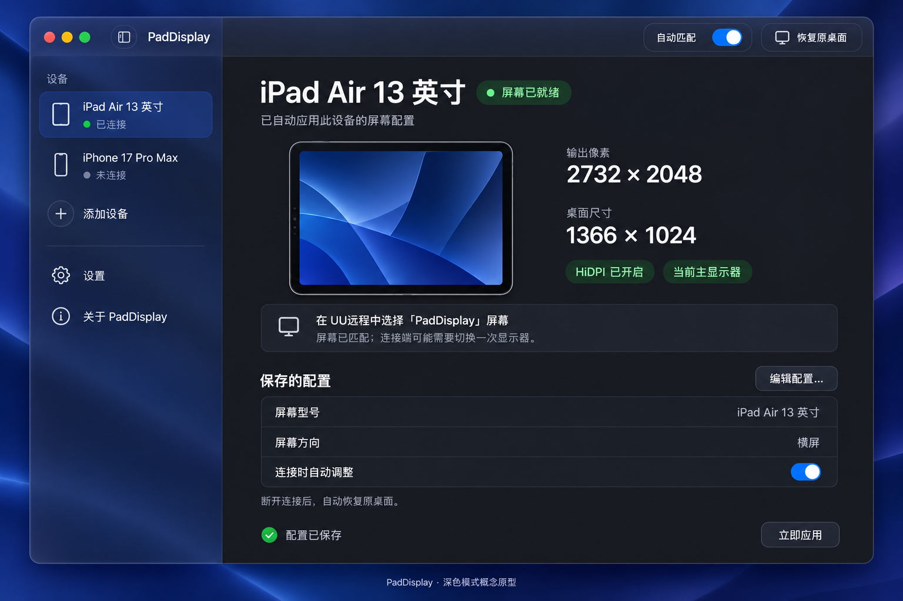

# PadDisplay · macOS Liquid Glass UI 原型 v1

2026-10-13。范围：主窗口、设备编辑、关于软件、菜单栏、设置与连接状态。当前交付为静态概念原型和交互规格，未修改应用源码、未打包或替换运行中的应用。后续原生实现以用户确认的设计为准。

## 原型图

| 图片 | 内容 |
| --- | --- |
| [01-main-light.png](01-main-light.png) | 浅色主窗口，iPad 已连接并自动匹配 |
| [02-main-dark.png](02-main-dark.png) | 同一布局的深色模式 |
| [03-editor-about-menu.png](03-editor-about-menu.png) | 设备编辑、作者信息、菜单栏操作 |
| [04-settings-and-states.png](04-settings-and-states.png) | 设置、首次授权、准备屏幕、恢复暂停、多连接与恢复失败 |

使用内置 `image_gen` 生成，并逐图检查主要文案、像素参数、署名与号码。完整提示词保存在 [prompts.json](prompts.json)。图片里的状态和版本是设计示例，不是新 UI 的实际运行证据。

## 布局与视觉规格

- 主窗口建议默认约 1040 × 720 pt，最小约 900 × 620 pt；侧边栏约 228 pt，可由系统控制收起和调宽。尺寸是设计目标，实际实现需验证窗口缩放、中文字体和辅助功能设置。
- 左侧设备列表负责选择；右侧呈现当前选择的状态、尺寸、预览和配置摘要。添加设备、设置、关于都有明确入口。
- 顶部工具栏集中放全局“自动匹配”和“恢复原桌面”；前者表示运行策略，后者是一次主动恢复动作。单设备的“连接时自动调整”放在该设备的配置区域。
- 内容采用 8 pt 间距节奏；主内容左右留白约 28–32 pt。正文约 13–14 pt，主标题约 24–28 pt，输出像素约 28–32 pt。数字与标签分层，重要文字保持可选中。
- 色彩使用系统主色、次级文字色和分隔色；蓝色用于主要操作，绿 / 黄 / 红辅助表达就绪、冲突与失败。状态同时具有文字和图标。
- 主窗口与设置跟随系统浅色 / 深色外观。设置里的“跟随系统外观”为说明项，现阶段不增加独立主题设置。
- 标题栏、工具栏、侧边栏、按钮、菜单与浮层优先使用原生组件，由系统提供 Liquid Glass；内容区使用可读的系统背景和标准材质。设备预览是宽高比例示意，不读取远程桌面截图。
- 实现时由系统提供窗口控件、焦点边框、弹出菜单与滚动边缘效果。图中玻璃高光和阴影用于表达设计方向，不作为手工绘制窗口装饰的要求。
- 开启“减少透明度”“增强对比度”“减少动态效果”后，遵循系统材质、颜色和动画适配，保持信息层次。

设计依据：[Apple Materials](https://developer.apple.com/design/human-interface-guidelines/materials)、[Adopting Liquid Glass](https://developer.apple.com/documentation/technologyoverviews/adopting-liquid-glass)、[macOS 27 设计资源](https://developer.apple.com/news/?id=e2lxw9l1)。概念图遵循这些层次原则；真实 Liquid Glass 渲染、键盘操作与可访问性需要在原生实现后验证。

## 核心交互

| 操作 | 预期行为 |
| --- | --- |
| 选择设备 | 只切换查看的配置，不主动改变显示器。选中未连接设备时显示“配置预览 / 未连接”，实际连接设备仍在列表标记 |
| 添加设备 | 打开编辑浮层，创建本地草稿。未知设备默认“不调整”；保存之前不加入有效配置、不持久化、不应用默认 iPad 尺寸 |
| 编辑配置 | 打开当前设备的草稿。修改名称、型号、方向或像素时，当前屏幕保持原设置 |
| 选择型号 / 方向 | 预填正确像素；切换横竖屏交换宽高。方向是保存的偏好，不表示实时跟随设备旋转 |
| 保存设置 | 校验名称、重名、整数、640–8192 像素与 HiDPI 偶数要求。错误显示在对应字段并聚焦；校验通过才持久化。当前设备单独连接、自动匹配开启且未暂停时应用新配置，否则用于下次匹配 |
| 取消编辑 | 丢弃草稿，保留原配置。新增设备取消后不留下空配置 |
| 单设备“连接时自动调整” | 持久化该开关；启用时校验已保存尺寸，关闭时按当前策略恢复桌面。主窗口即时显示状态，成功使用行内反馈 |
| 立即应用 | 使用该设备已保存且有效的配置进入手动模式；图中按钮与自动匹配策略分开。手动屏幕保持到恢复、重新启用自动匹配或退出 |
| 恢复原桌面 | 显示恢复进度；完成后明确显示“本次连接已暂停自动调整”，保留“继续自动匹配”入口 |
| 继续自动匹配 | 清除手动模式与本次暂停，按当前确认的连接重新判断；未知设备进入配置提示，多连接继续暂停 |
| 移除设备 | 使用原生确认对话框，说明配置会移除。取消不改变配置；确认后重新评估当前连接 |
| 关闭主窗口 / 退出 | 关闭窗口继续在菜单栏运行；退出通过已有恢复流程完成。失败时保留恢复记录并显示实际失败状态 |

准备、切换、恢复期间显示原生进度指示，暂时禁用重复“立即应用 / 恢复”操作。编辑浮层中的保存按钮在提交及应用期间反馈忙碌状态。显示信息基于确认后的结果，连接已识别与屏幕已就绪分开表达。

保存和复制成功使用短暂的行内反馈；系统授权、失败和移除确认使用合适的原生提示，成功操作不连续弹出模态提醒。

## 状态文案与动作

| 状态 | 主文案 | 辅助文案 / 动作 |
| --- | --- | --- |
| 未授权 | 允许识别连接设备 | 打开系统设置，用户在系统隐私设置中允许 PadDisplay；保留手动应用入口 |
| 等待连接 | 等待远程设备连接 | 按设备保存的配置自动匹配 |
| 未知设备 | 此设备还没有屏幕配置 | “配置此设备”；预填完整连接名称，尺寸需用户确认 |
| 正在准备 | 正在准备屏幕… | 显示目标像素；完成后进入就绪或失败状态 |
| 成功 | 屏幕已就绪 | 显示确认的输出像素、逻辑桌面、HiDPI 和主屏状态；提示连接端选择 PadDisplay 屏幕 |
| 设备未连接 | 配置预览 | 主面板呈现保存参数，不将其标为实际运行模式 |
| 手动模式 | 手动屏幕已就绪 | “恢复原桌面”及“继续自动匹配” |
| 多连接 | 多个设备同时连接 | 保留一个连接后再自动匹配；同名设备也以连接数量判断 |
| 正在恢复 | 正在恢复原桌面… | 禁用重复恢复操作，保持窗口响应 |
| 用户主动恢复完成 | 已恢复原桌面 | 本次连接已暂停自动调整；“继续自动匹配” |
| 自然断开恢复完成 | 已恢复原桌面 | 等待下一次连接，不误显示为用户主动暂停 |
| 恢复失败 | 原桌面尚未恢复 | 恢复记录已保留，请重试；“重试恢复”。系统配置无响应时展示实际排障提示 |
| UU伴侣冲突 | UU伴侣正在调整显示器 | 提示先退出 UU伴侣，再由 PadDisplay 调整 |

连接名称暂不可读时显示正在确认的状态；连接数量变化时不沿用旧设备尺寸。应用不把无法读取、正在准备或恢复失败包装为“屏幕已就绪”。

## 关于软件

通过侧边栏、菜单栏和系统“PadDisplay → 关于 PadDisplay”打开独立的原生窗口。采用图标、产品名、描述、版本、作者信息和本地许可的简洁层次。

署名行：

> 作者：耳过清风 · 小红书号：5397290838

说明文案：

> 本软件开源免费，欢迎点赞与关注，支持作者持续更新。

组合为一段时使用：**作者：耳过清风 · 小红书号：5397290838。本软件开源免费，欢迎点赞与关注，支持作者持续更新。**

- “复制小红书号”复制纯号码 `5397290838`，按钮短暂显示“已复制”。作者内容集中放在关于窗口。
- “MIT 开源许可”展示随包的许可证。版本从 Info.plist 读取；图中的 0.1.1 为当前版本示例。
- 产品描述：“让远程桌面，刚好适合你的屏幕。”图标沿用当前蓝色双屏语义。

## 键盘与可访问性

- `⌘,` 打开设置；`⌘W` 关闭当前窗口；`⌘Q` 请求恢复并退出；关于入口放在标准应用菜单。
- 设备列表支持方向键选择；Tab / Shift-Tab 按合理顺序经过可操作控件。
- 编辑浮层支持 Return 保存、Escape 取消，校验失败时焦点定位首个错误字段。
- 编辑未保存的草稿时，关闭、切换或移除前使用原生“保存 / 放弃 / 取消”处理。
- 图标按钮有 VoiceOver 标签；设备名称、连接状态、尺寸与方向独立可读。焦点状态、无权限和禁用原因不只靠颜色表达。
- 狭窄窗口先由系统收起侧边栏、再使配置区滚动；预览可缩小，数字和保存 / 取消操作保持可读。文字长度变化不使用固定坐标截断。

## 后续原生验证

设计确认后实现 SwiftUI 的主窗口、编辑浮层、Settings、About 与菜单命令，再验证：浅色 / 深色、减少透明度、键盘与 VoiceOver、窗口缩放、输入错误与取消、权限状态、准备 / 恢复 / 多连接状态，以及真实 iPad / 手机切换。当前原型图不替代这些运行验收。
